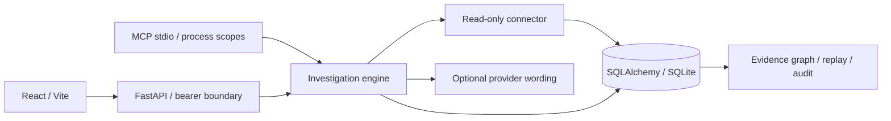

# Architecture
A modular monolith keeps domain behavior shared across HTTP and MCP.

Modules: models (validated contracts), connectors (authorized retrieval), engine (hypotheses and decisions), providers (structured JSON), db (records, investigations, events), api and mcp_server (transport adapters).

Intake validates incident ID and bounds question length. Retrieval selects records for the affected service; knowledge search ranks token overlap. Current hypotheses are deterministic domain rules, not calibrated inference. The detailed Northstar scenario uses a source-tag rule for scope rollouts and an alternative refresh hypothesis. Other incidents receive conservative, low-confidence diagnostic hypotheses. The question is retained in intake; it does not change rule-based hypotheses.

Actions and findings are JSON snapshots in SQLAlchemy rows. Approval uses a compare-and-swap update and is final in the API; failed concurrent updates return conflict. Actions remain not_executed. Each investigation has ordered, hash-chained events. Graph edges come only from service membership and hypothesis citation arrays.

SQLite is the supported local runtime. Set a PostgreSQL SQLAlchemy URL and install `.[postgres]` for PostgreSQL; portability is designed but not integration-tested here. No schema migration tooling, tenant isolation, SSO, durable job queue, pagination, retention, or distributed event sequencing is implemented. Use Alembic and explicit tenant keys before production.
